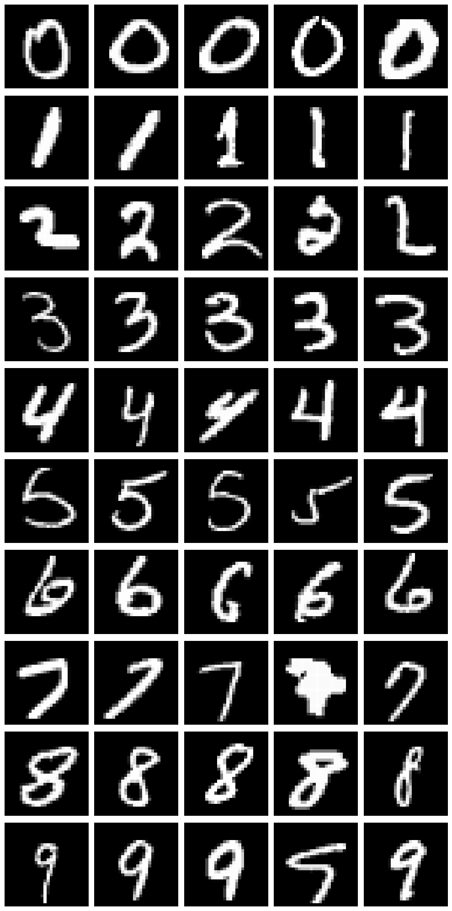
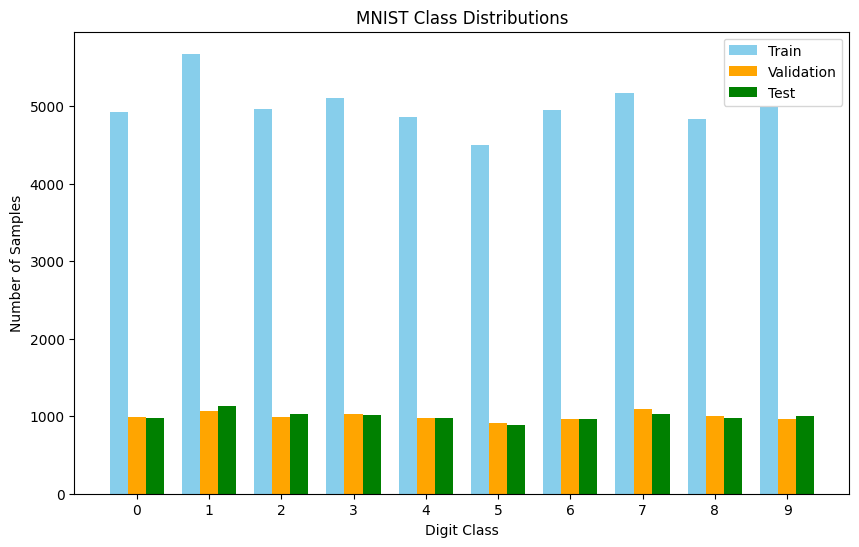
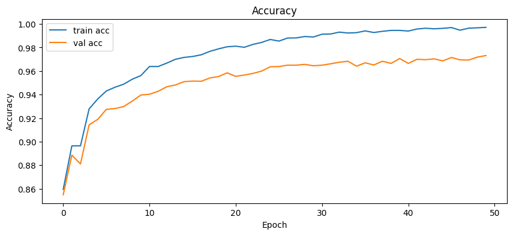
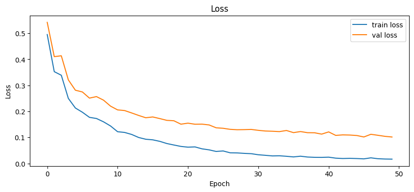
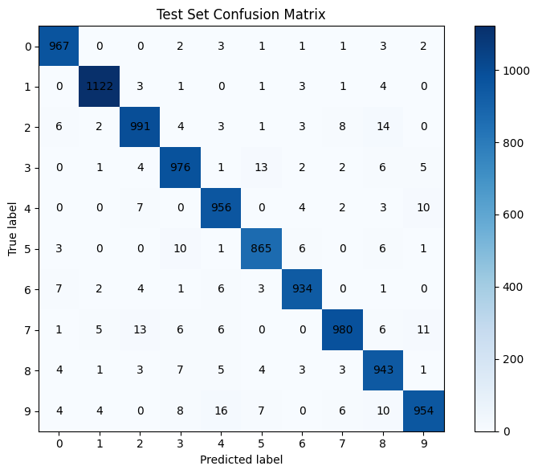
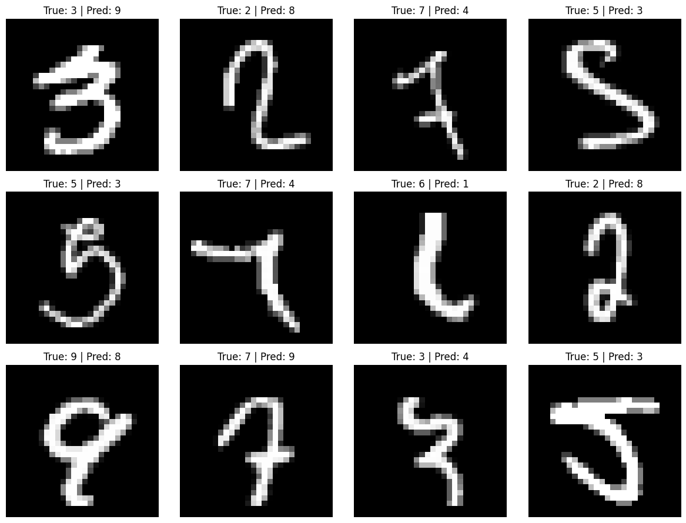

# Neural Networks from Scratch: MNIST Classification

**A NumPy implementation of a multilayer perceptron, with systematic experiments in optimization, architecture, and regularization.**

This project develops a fully connected neural network **without PyTorch, TensorFlow, or an automatic-differentiation library**. The goal is to study the mechanics of deep learning directly: forward propagation, backpropagation, parameter initialization, mini-batch optimization, regularization, and diagnostic evaluation. An accompanying collection of 12 experiment folders records the development of the model under different training choices.

**Best recorded result: 96.88% accuracy on the 10,000-image MNIST test set**, reproduced by running the repository's evaluation script with the included trained checkpoint.

## At a glance

| | |
|---|---|
| **Task** | Handwritten digit classification (10 classes) |
| **Dataset** | MNIST, 28 × 28 grayscale images |
| **Implementation** | Python + NumPy; manual forward/backward passes |
| **Selected architecture** | 784 → 64 (ReLU) → 10 (softmax) |
| **Trainable parameters** | 50,890 |
| **Training / validation / test** | 54,004 / 5,996 / 10,000 images |
| **Final train / validation accuracy** | 99.71% / 97.31% |
| **Held-out test accuracy** | **96.88%** (9,688 / 10,000 correct) |



## Research questions and approach

The work focuses on three practical questions:

1. **How can an end-to-end neural-network training system be implemented from first principles?** Layers, activations, loss functions, initialization, optimizers, backpropagation, and model serialization are written explicitly in NumPy.
2. **How do optimization and model-design choices influence learning?** Recorded variants investigate learning rate, feature standardization, batch size, momentum, hidden-layer width, L2 regularization, and early stopping.
3. **What can we learn beyond aggregate test accuracy?** Training/validation dynamics, per-digit accuracy, confusion pairs, and misclassified images are used to diagnose failure modes.

The emphasis is on **implementation transparency and empirical analysis**, rather than a claim of a new state-of-the-art architecture.

## Data and preprocessing

MNIST contains 60,000 standard training images and 10,000 held-out test images. The project's `mnist.pkl` is a preprocessed version containing an initial 50,000/10,000 training/validation split plus the 10,000-image test set. Each example is already flattened to 784 features with grayscale intensities scaled approximately to `[0, 1]`.

To reproduce the notebook's protocol, `rebuild_notebook_split` concatenates the original training and validation partitions and creates a **stratified 90%/10% split** with random seed `42`. This yields **54,004 training** and **5,996 validation** images; per-class integer truncation explains why the split is not exactly 54,000/6,000. The original 10,000-image test partition is kept separate.

Per-feature standardization is supported by the code (statistics are fitted on the training split only), but **is disabled in the selected configuration**. No data augmentation is used.



## Model and mathematical formulation

### Feedforward network

The selected model is a single-hidden-layer multilayer perceptron:

```text
Flattened image (784)  →  Dense (64)  →  ReLU  →  Dense (10)  →  Softmax
```

For layer `l`, a mini-batch of activations is transformed by

```math
Z^{(l)} = A^{(l-1)}W^{(l)} + b^{(l)},
\qquad A^{(l)} = \phi_l\!\left(Z^{(l)}\right).
```

The output uses a numerically stabilized softmax, subtracting the largest logit before exponentiation:

```math
p_{ic} = \frac{e^{z_{ic}-m_i}}{\sum_{j=1}^{10} e^{z_{ij}-m_i}},
\qquad m_i = \max_j z_{ij}.
```

The implementation also provides sigmoid, tanh, and linear activations, together with Xavier, He, normal, and uniform initialization. These are configurable alternatives; **the reported checkpoint uses normal initialization with standard deviation 1.0** for both dense layers.

### Loss and backpropagation

For a mini-batch of size `B`, categorical cross-entropy is

```math
\mathcal{L}_{\mathrm{CE}} =
-\frac{1}{B}\sum_{i=1}^{B}\sum_{c=1}^{10} y_{ic}\log p_{ic}.
```

The softmax–cross-entropy combination gives the output-layer error signal `P − Y`. Dense-layer gradients are computed explicitly, with an L2 gradient term on weights:

```math
\Delta^{(L)} = P-Y,
\qquad
\frac{\partial \mathcal{L}}{\partial W^{(l)}}
= \frac{(A^{(l-1)})^{\mathsf T}\Delta^{(l)}}{B} + \lambda W^{(l)},
\qquad
\frac{\partial \mathcal{L}}{\partial b^{(l)}}
= \frac{1}{B}\sum_{i=1}^{B}\Delta_i^{(l)}.
```

The backward pass propagates gradients through the dense and activation layers. Only weights, not biases, receive the L2 term. **Reported training/validation losses are cross-entropy values**; the logged metric does not add the L2 penalty.

### Optimization

The implementation supports standard stochastic gradient descent and SGD with momentum. The selected experiment uses momentum updates:

```math
v_t = \mu v_{t-1} - \eta\nabla_{\theta}\mathcal{L},
\qquad \theta_t = \theta_{t-1} + v_t.
```

| Hyperparameter | Selected value |
|---|---|
| Hidden units | 64 |
| Epochs | 50 |
| Mini-batch size | 16 |
| Learning rate | 0.01 |
| Optimizer | SGD with momentum |
| Momentum coefficient | 0.9 |
| L2 coefficient | 0.0001 |
| Weight initialization | Normal, mean 0, std. dev. 1 |
| Input standardization | Off |
| Early stopping | Off (implemented as an option) |
| Random seed | 42 |

All values are set in [`homework_code/config/config.json`](homework_code/config/config.json).

## Experimental results

The selected 50-epoch run reaches **99.71% training accuracy**, **97.31% validation accuracy**, and **96.88% held-out test accuracy**. Training metrics are recorded after each epoch; test accuracy is obtained from the final checkpoint. These figures refer to one configuration and one data split/seed, **not** a multi-run mean or a statistical confidence interval.

| Training and validation accuracy | Training and validation loss |
|:---:|:---:|
|  |  |

### Error analysis

The confusion matrix below is computed on the **10,000-example test split**, with rows representing true digits and columns representing predictions.



- **Digit 9** has the lowest test-set per-class recall: **94.55%**.
- The largest *symmetric* confusion pair is **4 ↔ 9** (**26** errors across both directions), followed by **3 ↔ 5** (**23**) and **2 ↔ 7** (**21**).
- The model correctly classifies **9,688** test images and misclassifies **312**. The errors include ambiguous stroke shapes and variations in handwriting; visual similarity is a plausible interpretation, not a separately validated causal finding.



### Iterative experiments

The [`outputs_images/`](outputs_images/) directory preserves results from **12 named experimental variants**. The recorded plots trace exploration of learning rate, standardization, mini-batch size, momentum, width, L2 regularization, and early stopping. Each run has available learning curves and confusion matrices; the notebook and saved `training_history.json` retain the detailed selected run.

These records document **iterative model development**, not a controlled factorial study: multiple settings can differ between variants, so individual improvements should not automatically be attributed to a single hyperparameter.

## Implementation structure

```text
.
├── README.md
├── requirements.txt
├── assets/                         # Selected figures used in this README
├── homework_code/
│   ├── config/config.json          # Model and training hyperparameters
│   ├── data/
│   │   ├── data_loader.py          # Load data, rebuild stratified split
│   │   └── dataset/                # Place mnist.pkl here (not tracked in Git)
│   ├── models/
│   │   ├── model.py                # Layers, losses, optimizers, backpropagation
│   │   └── saved_models/          # Trained checkpoint and training history
│   ├── notebooks/
│   │   ├── exploratory.ipynb      # Dataset exploration
│   │   └── initial__messy_codes.ipynb  # Original end-to-end experiment archive
│   ├── scripts/
│   │   ├── train.py                # Train and save a model
│   │   ├── evaluate.py             # Metrics, confusion matrix, error analysis
│   │   └── main.py                 # End-to-end train/evaluate command
│   └── utils/                      # Metrics and visualization functions
└── outputs_images/                # Plots for all experiment variants
```

The training code is modular rather than framework-dependent: a configuration constructs the network, `fit` carries out mini-batch updates, and `save`/`load` persist the parameters and configuration. Evaluation reconstructs the same deterministic split before computing test metrics.

## Reproducing the results

**Requirements:** Python **3.10+**, NumPy, and Matplotlib. Jupyter is optional for notebooks.

1. Clone or download the repository and install the dependencies:

   ```bash
   python -m pip install -r requirements.txt
   ```

2. Place the original preprocessed `mnist.pkl` file at:

   ```text
   homework_code/data/dataset/mnist.pkl
   ```

   The loader expects a Python pickle structured as `((X_train, y_train), (X_val, y_val), (X_test, y_test))`, with flattened, scaled input arrays. **The raw MNIST IDX files are not directly interchangeable with this pickle.** This data file is excluded from the GitHub-ready package because it is approximately **220 MB**, exceeding GitHub's ordinary per-file limit. If you have the original project archive, use its copy; otherwise supply an equivalently prepared dataset. Only unpickle files from trusted sources.

3. From the **repository root**, evaluate the saved model:

   ```bash
   python homework_code/scripts/evaluate.py --no-plots
   ```

   To retrain, run either of the following:

   ```bash
   python homework_code/scripts/train.py
   # Or train and evaluate in one invocation:
   python homework_code/scripts/main.py --show-plots
   ```

   Training saves the model to `homework_code/models/saved_models/mnist_model.pkl` and the history to `homework_code/models/saved_models/training_history.json`. You can change model settings through `homework_code/config/config.json`. Running training overwrites these saved artifacts unless you first back them up.

   For an existing checkpoint without retraining:

   ```bash
   python homework_code/scripts/main.py --skip-train --eval-split test
   ```

> **Reproducibility note:** The data splitting procedure and network seed are fixed at 42, but exact results can still depend on environment and numerical implementation. The figures and checkpoint provide a record of the reported experiment; package versions and repeated-seed statistics were not originally logged.

## Limitations and next steps

This is a **fully connected** image classifier, so it does not exploit spatial structure in the way a convolutional model would. Its scope is a from-scratch training and diagnostic pipeline for MNIST, **not a claim of novel theoretical methods or competitive state-of-the-art performance**. Useful extensions include multiple-seed reporting with uncertainty, more tightly controlled hyperparameter ablations, finite-difference gradient checks, explicit tests for loss/activation compatibility, and comparisons against convolutional baselines.

## References

- LeCun, Y., Cortes, C., and Burges, C. J. C., [*The MNIST Database of Handwritten Digits*](https://yann.lecun.com/exdb/mnist/).
- LeCun, Y., Bottou, L., Bengio, Y., and Haffner, P. (1998). [*Gradient-Based Learning Applied to Document Recognition*](https://doi.org/10.1109/5.726791). *Proceedings of the IEEE*, 86(11), 2278–2324.
